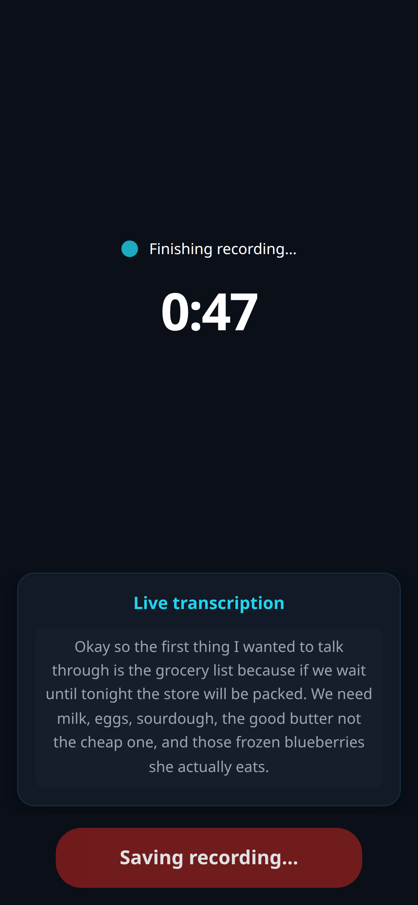
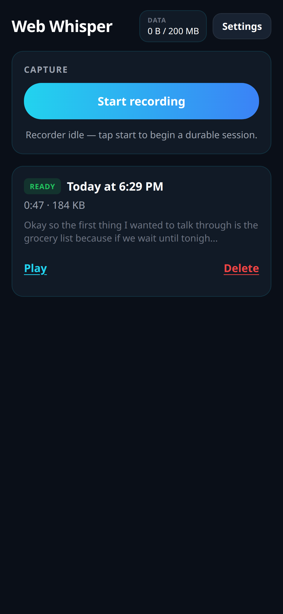

Spec Status: resolved
Spec Type: feedback
Created: 2026-11-09T18:24:00Z
Resolved: 2026-11-09T18:32:00Z
Product: apps/web-whisper-pwa

# Feedback: Stop flow — instant busy state, wait for persist + last transcription, 5s UI cap

## User Feedback (Dave, iPhone PWA)

When he taps Stop, nothing visibly happens for a moment (the app is flushing / waiting for events), so it looks like the tap was ignored. Then it jumps straight back to the list page, which briefly shows “all transcribed except one”, and a second or two later flips to fully recorded/transcribed.

## Requested Outcome

One job only — the Stop flow. Do not touch wake-lock / screen-sleep code.

1. **Instant busy state (same frame as the tap).** Switch the recording button/screen to a clear busy state, e.g. **Finishing recording…** / **Saving recording…**. Disable the control so it cannot be double-tapped.
2. **Stay on the recording screen** in that state until the final chunk is persisted **and** its transcription finishes, within reason. Cap the wait at about **5 seconds** (named constant). Then go to the list.
3. **If the wait times out**, go to the list anyway. Existing partial / coverage status handles the rest.
4. **Never drop or abandon audio.** The wait is UI only. The flush / persist queue keeps retrying regardless. Use the existing `flushPending` path. Absolute durability rules apply (`docs/DURABILITY-CONTRACT.md`).

## Package boundaries

- **This spec is PWA-only** (`apps/web-whisper-pwa`).
- Capture-engine interface is unchanged. After Stop the PWA already calls `handle.stop()` then `flushPending()`. That work must continue even if the UI timeout fires.
- Transcription-client interface is unchanged. Last-snip transcription already runs through `ingestGrowingSession` / `transcribeSession`. Do not cancel those promises on timeout.
- Wake-lock / `src/wakeLock.ts` is owned by a separate agent. Do not edit it.

## Customer contracts

If Stop-flow wiring of `flushPending` / last-snip transcription changes how the PWA uses those packages, update both sides:

- `packages/lib/capture-engine/customers/web-whisper-pwa.md`
- `packages/lib/transcription-client/customers/web-whisper-pwa.md`
- `apps/web-whisper-pwa/customers/README.md` and the PWA README orchestration section

No new producer APIs.

## Design

### Instant UI

On Stop tap, before any `await`:

- Recording HUD label → `Finishing recording…`
- Stop button label → `Saving recording…`
- Button `disabled` (and ignore further taps)
- Remain on the recording screen (`screen === 'recording'`)

Named copy lives next to the timeout constant so tests and UI cannot drift.

### UI wait (not durability)

`STOP_FINISH_WAIT_MS = 5000`.

The PWA races:

1. Final-chunk persist (`handle.stop()` already waits persist-idle; then existing `flushPending()`)
2. Trailing snip commit + its transcription (`ingestGrowingSession({ includeTrailing: true })` then existing `transcribeSession`)

against the cap, starting at the Stop tap.

- If both finish first → navigate Home with the session typically READY.
- If the cap fires first → navigate Home anyway. Persist and transcription **keep running**. List coverage / PART TX is the fallback.

Retention (`enforceCap` / `flushPending` then `enforceRetentionPolicy`) must not be cancelled. It is not part of the UI wait.

`navigate === 'none'` (pagehide / freeze) stays a durability path: stop + flush, no 5s UI wait, no transcription requirement.

### Durability (non-negotiable)

FORBIDDEN: cancelling `flushPending`, dropping the persist queue, “retry once then move on”, or navigating in a way that aborts encoded-chunk writes.

The timeout only stops **waiting to leave the recording screen**.

## Tests

Unit tests (no mic, fake timers / short timeout override):

- Stop tap → phase `finishing`, disabled button, busy copy, second tap ignored
- Persist + last transcription before the cap → `settled`
- Either side still pending when the cap fires → `timed_out`
- Timed-out work **still completes** after the UI has moved on (do not cancel the promise)

## Proof

Keep the PR **draft** until iPhone viewport (Chrome DevTools iPhone device mode) screenshots are in the PR body:

1. Instant **Finishing recording…** state
2. Home list after Stop with the session **fully transcribed** (READY)

QA helpers: `?screenshot=record-finishing`, existing `?screenshot=home-after-stop`.

## Out of scope

- Wake lock / screen sleep
- capture-engine persist-queue internals
- transcription-client retry policy
- Session detail, snip algorithm, retention policy changes
- Home tile live PART TX → READY animation (already exists)

## Resolution Criteria

Mark this spec resolved when:

- [x] Stop tap paints busy copy and disables the button before any flush/await
- [x] Recording screen stays up until persist + last transcription, or `STOP_FINISH_WAIT_MS`
- [x] Timeout navigates Home without cancelling `flushPending` / transcription
- [x] Unit tests cover state transitions and timeout (including “work continues after timeout”)
- [x] Customer docs updated on both sides of any usage-contract change
- [x] iPhone DevTools screenshots in `documentation/qa/` and the PR body
- [x] PR kept draft until those shots are in the body
- [x] `make build` published `docs/` PWA artifacts
- [x] `src/wakeLock.ts` untouched
- [x] Spec updated with a Resolution section

## Resolution

**Resolved:** 2026-11-09T18:32:00Z on branch `cursor/stop-flow-busy-state-b56b` (draft PR).

### What shipped (PWA only)

1. **Same-frame busy UI** — Stop tap sets `stopFinishing` / local finishing before any `await`. HUD **Finishing recording…**, button **Saving recording…**, `disabled`. Named copy + `STOP_FINISH_WAIT_MS = 5000` in `src/stopFlow.ts`.
2. **UI wait** — `finishCapture('home')` races persist (`handle.stop()` + existing `flushPending()`) and trailing ingest + `transcribeSession` against the 5s cap, then navigates Home. `navigate === 'none'` is unchanged (durability only).
3. **Timeout does not cancel work** — `waitForStopReady` never aborts the persist/transcription promise. Coverage / PART TX remains the fallback. Retention still runs after persist idle and is not part of the UI wait.
4. **Tests** — `src/stopFlow.test.ts`: tap → finishing/disabled, second tap ignored, settled before cap, timed_out at cap, persist still completes after timeout.
5. **Contracts** — PWA README + `customers/README.md`; capture-engine and transcription-client `customers/web-whisper-pwa.md` (usage only; no new APIs).
6. **QA helper** — `?screenshot=record-finishing`. Home READY fixture remains `?screenshot=home-after-stop`.
7. `make build` published `docs/` PWA artifacts. `src/wakeLock.ts` not edited.

### Proof (iPhone device mode, 1170×2532)

Notes: `documentation/qa/stop-flow-finishing.md`
